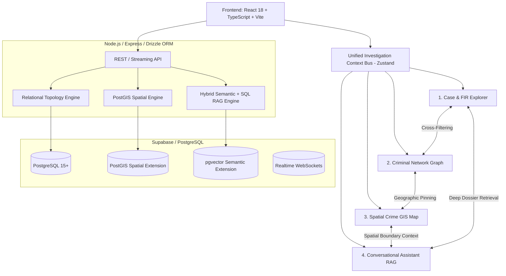
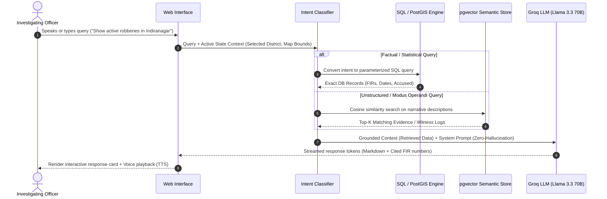

# System Architecture & Technical Specification

> **Platform:** Next-Generation Crime Intelligence & Tactical Operations System  
> **Target Environment:** Full-Stack Web Application (Local-First Development + Cloud Deployment)  
> **Philosophy:** High-velocity, zero-latency, cross-reactive intelligence—eliminating cloud friction while providing enterprise-grade spatial, relational, and generative AI capabilities.

---

## 1. System Overview & Design Philosophy

The platform is designed as an **Intelligence-First, Action-Oriented Operating System** for law enforcement and investigative agencies. Rather than functioning as isolated data silos, the system is linked through a **Unified Investigation Context Bus**:



### Key Architectural Differentiators
1. **Cross-Reactive Intelligence**: Selecting a criminal syndicate in the **Network Graph** automatically pins their incident hotspots on the **Crime Map**, filters their related records in the **FIR Explorer**, and primes the **Conversational Assistant** with suspect context.
2. **Local-First & Demo-Proof**: Runs 100% offline via local Supabase Docker or fallback SQLite/JSON stores, guaranteeing zero downtime from venue Wi-Fi during live presentations.
3. **Hybrid RAG Pipeline**: Combines deterministic relational SQL queries (for exact counts, dates, and penal sections) with vector similarity search (for narrative modus operandi and witness statements).

---

## 2. Technology Stack Selection

| Layer | Technology | Primary Role | Justification |
| :--- | :--- | :--- | :--- |
| **Frontend Framework** | **React 18 + Vite + TypeScript** | Client Application | Sub-second HMR, strict type safety across shared schema models. |
| **UI Design System** | **Tailwind CSS + shadcn/ui + Lucide** | Command-and-Control Dark Theme | Accessible, customizable components; military/SOC high-contrast visual aesthetic. |
| **State & Data Caching** | **Zustand + TanStack Query v5** | Context Bus & API Caching | Zustand handles cross-module active selection; React Query manages cache invalidation & polling. |
| **Backend Runtime** | **Node.js (v20+) + Express / Fastify** | API Gateway & Service Layer | Lightweight, universal JavaScript/TypeScript tooling with zero vendor lock-in. |
| **Database Engine** | **PostgreSQL 15+ (via Supabase)** | Relational, Vector & Spatial Store | Triple-engine in one: handles tabular data, PostGIS geometry, and pgvector embeddings. |
| **ORM / Data Access** | **Drizzle ORM** | Type-Safe Database Queries | Zero runtime overhead, auto-generates TypeScript types directly from PostgreSQL schema. |
| **Network Visualization** | **ReactFlow (`@xyflow/react`) + D3-Force** | Entity-Relationship Topology | Interactive node clustering, draggable graph layouts, custom suspect/gang node cards. |
| **Geospatial GIS** | **Leaflet + React-Leaflet + Turf.js** | Tactical Crime Mapping | 100% free; CartoDB Dark Matter tiles (zero API keys/credit cards needed); Turf.js handles client-side spatial math. |
| **Data Analytics** | **Apache ECharts (`echarts-for-react`)** | Tactical KPI & Trend Charts | Hardware-accelerated Canvas rendering, native dark theme, multi-dimensional timeline graphs. |
| **LLM & Inference** | **Groq Cloud API** (`llama-3.3-70b-versatile`) | Real-Time Conversational AI | Ultra-low latency streaming (~300ms time-to-first-token); free developer tier. |
| **Document Synthesis** | **`@react-pdf/renderer` or `jsPDF` + PapaParse** | Classified Dossiers & CSV | Client-side/edge synthesis of classified intelligence reports with dynamic watermarking. |

---

## 3. Core Feature Architecture (Primary)

### 3.1. Feature 1: Case / FIR Explorer & Unified Dossier Engine

The Case Explorer serves as the operational ledger for all criminal incident reports (FIRs).

```
               ┌────────────────────────────────────────────────────────┐
               │                  Case Explorer Pipeline                │
               └────────────────────────────────────────────────────────┘
                                           │
             ┌─────────────────────────────┼─────────────────────────────┐
             ▼                             ▼                             ▼
    [Multi-Faceted Filter]       [Trigram Full-Text Search]       [Dossier Drawer]
    - Crime Category             - FIR Number / Keyword           - Suspect Profiles
    - District / Station         - Accused / Alias Names          - Evidence Registry
    - Incident Date Range        - Applicable Statutory Acts      - Chain of Custody
    - Investigation Status       (PostgreSQL pg_trgm index)       - Geo-Incident Pin
```

#### Core Components
- **Data Table Engine**: Virtualized TanStack Table v8 with customizable column visibility, server-side pagination, and multi-field sorting.
- **Accused & Victim Entities**: Structured profiles tracking repeat offender history, alias flags, physical markers, and known gang affiliations.
- **Statutory Section Mapper**: Relational tagging of Penal Codes (e.g., IPC / BNS sections) with automated severity scoring.
- **Evidence Vault**: Track physical and digital evidence (CCTV, CDR phone logs, weapons, forensic reports) tied to specific FIR records.
- **Lifecycle Transition State Machine**: Validates transitions (`Open` → `Under Investigation` → `Under Review` → `Closed` / `Chargesheet Filed`).

---

### 3.2. Feature 2: Criminal Network & Syndicate Analysis

A graph intelligence engine designed to uncover organized syndicates, co-accused networks, and repeat offender rings across multiple police jurisdictions.

```
       [Accused Suspect] ──(Accomplice)── [Accused Suspect]
               │                                  │
          (Involved In)                      (Involved In)
               ▼                                  ▼
           [FIR 102/24]                      [FIR 215/24]
               ▲                                  ▲
               │                                  │
        (Shared Location)                  (Shared Location)
               └─────────► [Hub: Cyber Hub] ◄─────┘
```

#### Graph Schema & Algorithms
- **Node Entities**:
  - `SuspectNode`: Displays risk score, repeat offender badge, primary gang label.
  - `FirNode`: Represents incident node linking multiple co-actors.
  - `LocationNode`: Stations or high-density crime spots acting as geographic bridges.
  - `AssetNode`: Shared getaway vehicles, phone IMEI/CDR numbers, or bank accounts.
- **Dynamic Relationship Edges**:
  - `CO_ACCUSED_WITH`: Weight proportional to shared case frequency.
  - `OPERATES_IN`: District/station jurisdiction linkages.
  - `REPEATED_TARGET`: Links repeat offenders to specific modus operandi.
- **Layout & Interaction**:
  - Powered by `@xyflow/react` with custom SVG edge markers and animated pulse rings for high-risk targets.
  - Integration with `d3-force` simulation for automatic clustering of criminal syndicates.
  - **Syndicate AI Explainability**: Extracts the selected subgraph as JSON and prompts the LLM to generate an executive threat profile summarizing the syndicate's hierarchy and vulnerabilities.

---

### 3.3. Feature 3: Crime Map & Spatial Intelligence

Geospatial command center providing macro-level territory oversight and micro-level tactical patrol routing.

```
┌───────────────────────────────────────────────────────────────────────────┐
│ Crime GIS Spatial Engine                                                  │
├──────────────────────────┬────────────────────────────────────────────────┤
│ Base Layers              │ CartoDB Dark Matter / Satellite Vector Tiles   │
├──────────────────────────┼────────────────────────────────────────────────┤
│ Analytical Layers        │ - Category-specific animated markers           │
│                          │ - Dynamic Kernel Density Heatmap (leaflet.heat)│
│                          │ - Spatial Clusters (leaflet.markercluster)     │
├──────────────────────────┼────────────────────────────────────────────────┤
│ PostGIS Query Pipeline   │ - ST_DWithin: Radius search around an officer  │
│                          │ - ST_Contains: Geofenced bounding box analysis │
│                          │ - ST_ConcaveHull: Territorial gang polygon map │
├──────────────────────────┼────────────────────────────────────────────────┤
│ Turf.js Browser Engine   │ Real-time polygon intersection & centroid calc │
└──────────────────────────┴────────────────────────────────────────────────┘
```

#### Area Intelligence & Patrol Recommender
- **Bounding Box & Lasso Tool**: Users draw arbitrary polygon zones on the map to trigger an on-the-fly area breakdown.
- **Incident Aggregator**: Computes crime density, high-risk operational hours (e.g., peak burglary hours between 01:00–04:00), and dominant crime types.
- **AI Tactical Guidance**: Generates localized patrol recommendations and optimal checkpoint positioning based on historical incident vectors.

---

### 3.4. Feature 4: Conversational Intelligence Assistant

A bilingual (English + Regional/Kannada), grounded RAG copilot for field officers and intelligence analysts.



#### Key Capabilities
- **Strict Grounding**: Zero fictitious case citations. The model must reference explicit FIR numbers and police stations returned in the retrieval envelope.
- **Bilingual Interface**: Seamless translation and natural conversation in Kannada (ಕನ್ನಡ) and English, supporting voice input (STT) and voice responses (TTS).
- **Context Injection**: Incorporates the user’s active screen state (e.g., currently viewed suspect, filtered date window, or map viewport) into the LLM system prompt.

---

## 4. Secondary Feature Architecture (Phased Implementation)

### 4.1. Feature 5: Targeted Tactical Analytics Dashboard
*Purpose: Provide high-signal tactical clarity without vanity dashboard clutter.*

- **Incident Velocity Meter**: 30-day rolling rate comparing current crime incidence against the previous period.
- **Recidivism Index**: Percentage of open cases involving repeat offenders with prior arrest records.
- **District Workload Matrix**: Heatmap matrix showing clearance rates and pending investigations per station.
- **Anomaly Detection**: Flags sudden statistical deviations (e.g., a 40% surge in two-wheeler thefts within 7 days in a single sector).

### 4.2. Feature 6: Official Classified Report Synthesis
*Purpose: Generate court-admissible and operational intelligence briefs in seconds.*

- **Classified PDF Generator**: Client-side synthesis producing official department dossiers with security watermarks, case summaries, suspect rosters, and evidence matrices.
- **CSV Data Dump**: Filtered tabular exports protected against CSV Formula Injection (CWE-1236).
- **Chain of Custody Logs**: Timestamped audit trails recording when reports are generated and by which badge ID.

---

## 5. Database Schema Specification (PostgreSQL / Supabase)

```sql
-- Enable Extensions
CREATE EXTENSION IF NOT EXISTS "uuid-ossp";
CREATE EXTENSION IF NOT EXISTS "postgis";
CREATE EXTENSION IF NOT EXISTS "vector";
CREATE EXTENSION IF NOT EXISTS "pg_trgm";

-- 1. Officers & Personnel Table
CREATE TABLE officers (
    id UUID PRIMARY KEY DEFAULT uuid_generate_v4(),
    badge_number VARCHAR(50) UNIQUE NOT NULL,
    name VARCHAR(255) NOT NULL,
    email VARCHAR(255) UNIQUE NOT NULL,
    role VARCHAR(50) DEFAULT 'Investigator', -- 'Investigator', 'StationInCharge', 'Superintendent'
    station VARCHAR(100) NOT NULL,
    district VARCHAR(100) NOT NULL,
    created_at TIMESTAMP WITH TIME ZONE DEFAULT NOW()
);

-- 2. Master FIR Cases Table
CREATE TABLE cases_fir (
    id UUID PRIMARY KEY DEFAULT uuid_generate_v4(),
    fir_number VARCHAR(100) UNIQUE NOT NULL,
    crime_category VARCHAR(100) NOT NULL,
    priority VARCHAR(50) DEFAULT 'Medium', -- 'Low', 'Medium', 'High', 'Critical'
    status VARCHAR(50) DEFAULT 'Open',     -- 'Open', 'Under Investigation', 'Under Review', 'Closed'
    incident_date TIMESTAMP WITH TIME ZONE NOT NULL,
    reported_date TIMESTAMP WITH TIME ZONE DEFAULT NOW(),
    district VARCHAR(100) NOT NULL,
    police_station VARCHAR(100) NOT NULL,
    investigating_officer_id UUID REFERENCES officers(id),
    description TEXT NOT NULL,
    applicable_acts JSONB DEFAULT '[]'::jsonb, -- e.g., ["IPC 302", "IPC 120B"]
    
    -- Spatial Geometry (WGS84 Lat/Long)
    latitude DOUBLE PRECISION NOT NULL,
    longitude DOUBLE PRECISION NOT NULL,
    location_geom GEOMETRY(Point, 4326),

    -- Semantic Embedding for Vector RAG (1536-dim or 768-dim)
    embedding VECTOR(1536),
    
    created_at TIMESTAMP WITH TIME ZONE DEFAULT NOW(),
    updated_at TIMESTAMP WITH TIME ZONE DEFAULT NOW()
);

-- Spatial & Search Indexes
CREATE INDEX idx_firs_geom ON cases_fir USING GIST (location_geom);
CREATE INDEX idx_firs_trgm ON cases_fir USING GIN (fir_number gin_trgm_ops, description gin_trgm_ops);

-- 3. Accused & Suspect Entities
CREATE TABLE entities_accused (
    id UUID PRIMARY KEY DEFAULT uuid_generate_v4(),
    full_name VARCHAR(255) NOT NULL,
    aliases JSONB DEFAULT '[]'::jsonb,
    is_repeat_offender BOOLEAN DEFAULT FALSE,
    risk_level VARCHAR(50) DEFAULT 'Medium', -- 'Low', 'Medium', 'High', 'Critical'
    gang_affiliation VARCHAR(100),
    phone_numbers JSONB DEFAULT '[]'::jsonb,
    known_addresses JSONB DEFAULT '[]'::jsonb,
    created_at TIMESTAMP WITH TIME ZONE DEFAULT NOW()
);

-- 4. Junction: Cases <-> Accused (Many-to-Many with Role)
CREATE TABLE case_accused_junction (
    id UUID PRIMARY KEY DEFAULT uuid_generate_v4(),
    case_id UUID NOT NULL REFERENCES cases_fir(id) ON DELETE CASCADE,
    accused_id UUID NOT NULL REFERENCES entities_accused(id) ON DELETE CASCADE,
    role VARCHAR(100) DEFAULT 'Prime Suspect', -- 'Prime Suspect', 'Accomplice', 'Conspirator'
    status VARCHAR(50) DEFAULT 'Wanted',       -- 'Wanted', 'Arrested', 'Bailed', 'Acquitted'
    UNIQUE(case_id, accused_id)
);

-- 5. Evidence Vault Table
CREATE TABLE case_evidence (
    id UUID PRIMARY KEY DEFAULT uuid_generate_v4(),
    case_id UUID NOT NULL REFERENCES cases_fir(id) ON DELETE CASCADE,
    evidence_type VARCHAR(100) NOT NULL, -- 'CCTV', 'Weapon', 'Digital / CDR', 'Forensic'
    description TEXT NOT NULL,
    file_url TEXT,
    collected_date TIMESTAMP WITH TIME ZONE DEFAULT NOW(),
    chain_of_custody JSONB DEFAULT '[]'::jsonb
);

-- 6. AI Conversation Threads Table
CREATE TABLE ai_threads (
    id UUID PRIMARY KEY DEFAULT uuid_generate_v4(),
    officer_id UUID REFERENCES officers(id),
    title VARCHAR(255) NOT NULL,
    created_at TIMESTAMP WITH TIME ZONE DEFAULT NOW(),
    messages JSONB DEFAULT '[]'::jsonb
);
```

---

## 6. Reactive State & Context Bus Architecture

To ensure seamless coordination between screens, the application uses a centralized Zustand store (`useInvestigationContext`):

```ts
export type TacticalLensMode = 'geo' | 'network' | 'dossier';

interface InvestigationContextState {
  // Lens Projection Mode
  lensMode: TacticalLensMode;
  setLensMode: (mode: TacticalLensMode) => void;

  // Active Filter Scope
  filters: {
    district: string | null;
    crimeCategory: string | null;
    dateRange: [Date | null, Date | null];
    severity: string | null;
  };
  setFilters: (filters: Partial<InvestigationContextState['filters']>) => void;

  // Temporal Scrubber (Time-Travel Playback)
  timeline: {
    currentTime: Date;
    windowStart: Date;
    windowEnd: Date;
    isPlaying: boolean;
    playbackSpeed: number; // 1x, 2x, 5x
  };
  setTimelineTime: (time: Date) => void;
  togglePlayback: () => void;

  // Selected Entities (Persisted across morphing modes)
  activeCaseId: string | null;
  activeSuspectId: string | null;
  activeBoundingBox: [[number, number], [number, number]] | null; // Geo bounds

  setActiveCase: (caseId: string | null) => void;
  setActiveSuspect: (suspectId: string | null) => void;
  setActiveBoundingBox: (bounds: [[number, number], [number, number]] | null) => void;

  // Active Caseboard (Pinned Evidence & Notes)
  pinnedItemIds: string[];
  pinItem: (itemId: string) => void;
  unpinItem: (itemId: string) => void;

  // Ambient Copilot Query & Alert Envelope
  getPromptContextEnvelope: () => {
    lensMode: TacticalLensMode;
    activeFilters: object;
    focusedEntity: object | null;
    spatialSummary: string;
    temporalWindow: [Date, Date];
  };
}
```

---

## 7. Deployment & Hackathon Resilience Strategy

### 7.1. Cloud Production Topology
- **Client (Frontend)**: Deployed to **Vercel** with global CDN caching.
- **Server (Backend API)**: Deployed to **Render / Railway / Supabase Edge Functions**.
- **Database**: Managed **Supabase** instance (PostgreSQL 15 + PostGIS + pgvector).
- **AI Gateway**: **Groq API** with streaming token output.

### 7.2. "Zero-Failure" Offline Live Demo Topology
*If the presentation stage loses Internet connectivity, the architecture falls back seamlessly:*

```
[Browser Client: localhost:5173]
       │
       ▼ (Direct Local HTTP)
[Local Node.js Express API: localhost:3000]
       │
       ├─► [Local Supabase Docker / SQLite fallback: localhost:54322]
       ├─► [Local CartoDB Offline Tile Cache / Mock Leaflet Canvas]
       └─► [Local Ollama (Llama 3.2) OR Deterministic Rule-Based RAG Engine]
```

1. **Pre-seeded Reference Dataset**: A 60-case high-fidelity mock dataset with realistic Indian penal code records, geospatial coordinates around Bengaluru/Karnataka, and pre-computed network linkages.
2. **Instant Hot Swap**: Toggling `VITE_OFFLINE_MODE=true` immediately switches all remote API endpoints to in-memory local caches without restarting the frontend.

---

## 8. Development Roadmap & Implementation Milestones

```mermaid
gantt
    title System Implementation Roadmap
    dateFormat  X
    axisFormat %s
    section Phase 1: Core Foundation
    DB Schema Setup & PostGIS Migration     :0, 1
    Case / FIR Explorer & Data Grid         :1, 3
    section Phase 2: Visual Intelligence
    Crime Map & Tactical Heatmap Engine    :2, 4
    Criminal Network Graph & Clustering     :3, 5
    section Phase 3: AI Copilot
    Hybrid RAG Pipeline & Intent Engine     :4, 6
    Bilingual Kannada/English & Voice UI    :5, 7
    section Phase 4: Polish & Secondary
    Tactical Analytics & Anomaly Cards      :6, 7
    Classified PDF Dossier Generator        :7, 8
    Live Presentation Dry Run & Hardening   :7, 8
```


