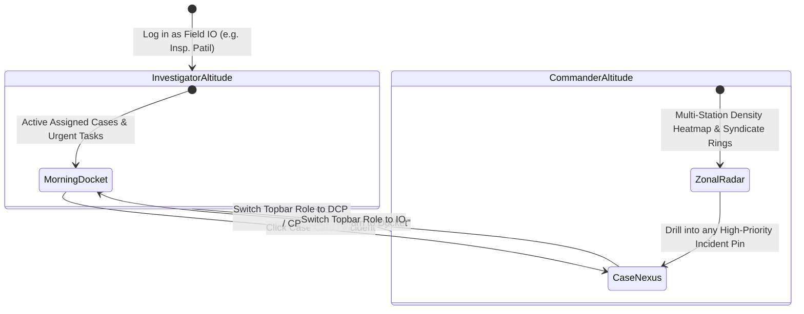

# UI/UX Design Specification: The Kestrel Officer Command Deck

> **Project:** Kestrel — Next-Generation Police Intelligence & Tactical Command System  
> **Interaction Model:** Unified Single-Surface War Room (Morphing Tactical Lens + Dual Command Altitudes + Ambient AI Copilot + Temporal Scrubber)  
> **Operational Paradigm:** Officer-First Mental Model (Daily Shift Docket $\rightarrow$ 360° Case Nexus $\leftrightarrow$ High-Level Zonal Command Deck)  
> **Visual Aesthetic:** High-Contrast Cyber-Tactical Military SOC (Deep Slate/Navy `#050b14`, Electric Cyan `#06b6d4`, Neon Amber `#f59e0b`, Tactical Crimson `#ef4444`)

---

## 1. The Interaction Paradigm Shift

### 1.1. Why Traditional Law Enforcement UIs Fail
Standard police intelligence software suffers from **context fragmentation**:
* An officer clicks a sidebar to go to `/cases`, searches a name, and copies an FIR number.
* They click `/map` to see where it happened, losing their place in the table and re-typing the coordinates.
* They click `/network` to see connected gang members, having to search the name again.
* They click `/ai` to ask questions in an isolated chatbot bubble with zero knowledge of what they were just inspecting.
* Worse, they are forced to browse abstract city-wide KPI charts rather than actionable daily dockets, statutory remand countdowns, and court-mandated deadlines.

This constant back-and-forth context switching breaks investigator flow and hides non-obvious criminal connections.

### 1.2. The New Paradigm: The "Kestrel Officer Command Deck"
Instead of separate disjointed pages, the entire system operates as a **single, responsive, multi-modal Tactical Deck** with **Dual Operational Altitudes**:

```
┌────────────────────────────────────────────────────────────────────────────────────────────────────────────────────────┐
│ TOP BAR: [🛡️ KESTREL CIOS]  [Role: 👮 Insp. Patil (IO) ▾]  [Station: Indiranagar PS]  [Cmd+K Search]  [Mode: LIVE ●]  │
├─────────────────────────────────────────────────────────────────────────────────────────────┬──────────────────────────┤
│                                                                                             │                          │
│                                  THE TACTICAL LENS                                          │     AMBIENT COPILOT      │
│                                (Continuous Morphing Canvas)                                 │     (Live AI Stream)     │
│                                                                                             │                          │
│  [MODE: 📋 OFFICER DOCKET | 🔍 360° CASE NEXUS | 🌐 ZONAL STRATEGIC RADAR]                  │  • Proactive MO Flashes  │
│                                                                                             │  • Witness Analysis      │
│  WHEN CASE NEXUS ACTIVE:                                                                    │  • Bilingual (KN / EN)   │
│  ┌───────────────────────────────────────────────────────────────────────────────────────┐  │  • One-Click Bail Pet.   │
│  │ SUB-LENS: [ 📄 DOSSIER & EVIDENCE ]  [ 🗺️ CRIME SCENE GIS ]  [ 🕸️ SYNDICATE GRAPH ]  │  │                          │
│  ├───────────────────────────────────────────────────────────────────────────────────────┤  │  ┌────────────────────┐  │
│  │                                                                                       │  │  │ Query or Command... │  │
│  │  • Active FIR: #102/24 (Armed Robbery - 12th Main Indiranagar)                        │  │  └────────────────────┘  │
│  │  • Primary Accused: Raju alias Snake (4 Priors, Bailed)                               │  ├──────────────────────────┤
│  │  • Action Checklist: [x] Seizure memo  [ ] Ballistics FSL  [ ] Interrogate Accomplice │  │ 📌 ACTIVE CASEBOARD   │
│  │  • Integrated Scene Map / Network visualizers embedded seamlessly                     │  │ (3 Pinned Clues)      │
│  │                                                                                       │  │ [Export PDF Briefing] │
│  └───────────────────────────────────────────────────────────────────────────────────────┘  │                          │
├─────────────────────────────────────────────────────────────────────────────────────────────┴──────────────────────────┤
│ BOTTOM RAIL: Temporal Incident Scrubber [ ⏪ ◀ PLAY ▶ ⏩ ]  ──●────────────────────────────── [ 1x / 2x / 5x Speed ]   │
└────────────────────────────────────────────────────────────────────────────────────────────────────────────────────────┘
```

---

## 2. Dual Command Altitudes (Role-Based Projections)

The system serves both ground investigators and zonal police leadership using the **exact same core data engine**, but projecting at different operational altitudes:



### 2.1. Altitude 1: Field Investigating Officer (IO - PSI / PI)
* **Operational Scope**: My Police Station, My Assigned FIRs, My Interrogations.
* **Primary Objective**: Advance daily inquiries, track seized evidence, interrogate accused, and file court-ready charge-sheets before statutory custody clocks expire.
* **Core Views**:
  1. **The Morning Docket (`DocketLens`)**: 3-column triage of assigned cases (Critical Violent, In-Progress, Statutory Remand Countdown) and today's shift task checklist.
  2. **The 360° Case Nexus (`CaseNexusLens`)**: The single-case war room unifying evidence, crime scene radius, and accused ego-network.

### 2.2. Altitude 2: High-Level Command (DCP / ACP / Commissioner)
* **Operational Scope**: Zonal / Multi-Station / City-Wide (e.g., Bengaluru East Division).
* **Primary Objective**: Detect cross-jurisdiction syndicates, allocate night patrol units to crime surges, monitor station clearance rates, and generate ministerial/court briefings.
* **Core Views**:
  1. **Zonal Crime Heatmap (`ZonalStrategicLens`)**: PostGIS incident density fields and dynamic night patrol hotspot checkpoints.
  2. **Inter-Station Syndicate Topology**: Macro graph connecting gang syndicates across station perimeters.
  3. **Station Accountability Matrix**: Live ranking of station clearance velocities and overdue charge-sheet warnings under Section 187 BNSS (167 CrPC).

---

## 3. Core Interaction Pillars

### 3.1. Pillar 1: The 360° Case Nexus (The Core Workbench)
When an officer clicks on an assigned FIR (or a high-level commander drills into an incident), the Tactical Lens smoothly expands into the **360° Case Nexus**. The officer never leaves the case:

1. **Sub-Lens 1: Evidentiary Dossier & Seizure Vault**:
   * Official case registration details, complainant/victim statements, applicable acts (IPC/BNS).
   * Accused suspect profile cards with prior conviction badges, aliases, and bail status.
   * Seizure panchnama cards: weapons (ballistics status), recovered gold, getaway vehicle plate logs.
   * **In-Case Action Checklist**: Directly check off investigative steps (CCTV retrieved, 180 BNSS statement recorded, FSL dispatched).
2. **Sub-Lens 2: Crime Scene Spatial GIS**:
   * Leaflet map auto-centers on the crime scene coordinates with dark tactical tiles and a pulsing radar beacon.
   * Overlays an interactive **500m & 1km surveillance radius**:
     * Geo-tagged residences of known local repeat offenders.
     * Station CCTV camera locations with viewing angles.
     * Field patrol beat checkpoints.
   * Clicking any nearby suspect displays straight-line distance (`"Resides 850m away"`).
3. **Sub-Lens 3: Syndicate Relational Graph**:
   * Renders a focused **Ego-Network** powered by `@xyflow/react` centered on this case's accused.
   * Visualizes direct co-accused pairs, shared getaway vehicle links, and stolen property receivers.
   * Selecting a node immediately loads that criminal's dossier into the Ambient Copilot.

---

### 3.2. Pillar 2: The Ambient AI Copilot (Omnipresent Sidecar)
The Copilot is **never isolated on a separate page**. It occupies a persistent 35% right-hand rail that functions as an intelligent partner sitting next to the investigator:

1. **Passive Proactive Awareness**:
   * As the officer opens cases or pans the map, the Copilot surfaces **"Live Intelligence Flashes"**:
     > *"⚠️ MO Correlation Detected: FIR #102/24 shares the exact Modus Operandi as FIR #88/24 (Indiranagar). In both incidents, two attackers used a crowbar on rear shutters and fled on a two-wheeler (KA-04-E-1234)."*
2. **One-Click Action Execution & Legal Drafting**:
   * **Bail Opposition Petition**: Click `[⚡ Draft Bail Opposition]` $\rightarrow$ Copilot synthesizes a court-ready affidavit citing prior FIR numbers, conviction records, and seized weapons.
   * **Witness Inconsistency Detection**: Flags discrepancies between complainant statements and physical CCTV logs.
3. **Bilingual Dual-Mode (English & Kannada / ಕನ್ನಡ)**:
   * Instant toggle between English and Kannada.
   * Full natural Kannada synthesis (`ಕನ್ನಡದಲ್ಲಿ ಜಾಮೀನು ವಿರೋಧ ಅರ್ಜಿ`) tailored for station sub-inspectors and constables.
4. **Grounded FIR Citations**:
   * AI responses contain clickable citation pills (e.g. `[FIR #88/24]`); clicking directly loads that case into the Case Nexus.

---

### 3.3. Pillar 3: Temporal Incident Scrubber (Time-Travel Playback)
Along the bottom edge sits a tactile, interactive timeline:

```
[ ⏮ ] [ ⏵ PLAY / ⏸ PAUSE ] [ ⏭ ]  ──●───────────────────────────────  [ 1x / 2x / 5x Speed ]
OCT 01                      OCT 14 (Active Head)               OCT 24 (Live)
├─ Burglary Surge (Indiranagar)   ├─ Repeat Offender Arrested    ├─ Live Incident Stream
```

* **Interactive Scrubbing**: Dragging the playhead backward dynamically rewinds the map markers and syndicate graph nodes, revealing how a criminal gang developed chronologically.
* **Canvas Synchronization**: Smooth opacity transitions (150ms) reveal incidents as the playhead advances.
* **Quick Presets**: `24 Hours`, `7 Days`, `30 Days`, `Full Quarter`.

---

### 3.4. Pillar 4: Active Caseboard & 1-Click Court Briefing PDF
* **One-Click Pinning**: Every case card, suspect node, CCTV snapshot, or AI flash has a quick `Pin (📌)` button.
* **The Caseboard Tray**: Pinned items dock into a collapsible bottom-right tray displaying the active investigation scratchpad.
* **Instant Court Briefing Dossier**: Clicking `"Export Court Briefing Dossier"` synthesizes all pinned items into an official printable PDF in under 2 seconds:
  * Official Karnataka State Police crest and station header.
  * Confidential security classification watermark.
  * Formal case summary, criminal history, and seizure list ready for court presentation.

---

## 4. Keyboard & HUD Efficiency Architecture

Law enforcement operations demand lightning-fast actions without hunting through deep dropdown menus:

| Hotkey / Shortcut | Action Triggered |
| :--- | :--- |
| `Cmd + K` or `Ctrl + K` | **Global Command Palette**: Omni-search across FIR numbers, suspect names, vehicle plates, or statutory sections. |
| `1` | **Switch to Morning Docket**: Instant return to assigned cases and shift tasks. |
| `2` | **Switch to 360° Case Nexus**: View the currently active or last opened FIR war room. |
| `3` | **Switch to Zonal Strategic Radar**: Macro heatmap and cross-station syndicate topology (DCP view). |
| `Alt + 1` / `2` / `3` | **Toggle Case Sub-Lenses**: Switch between Dossier, Crime Scene GIS, and Syndicate Graph. |
| `Esc` | Clears active focus, closes open modals, or returns to Docket. |
| `Shift + P` | Pins the currently selected case or suspect to the Active Caseboard. |

---

## 5. Visual Design System & Aesthetics

### 5.1. Color Palette: "Tactical Midnight"
High-contrast dark palette engineered for extended operation in low-light command control rooms and field tablets:

```css
:root {
  /* Background Foundations */
  --bg-deck-deep: #050b14;        /* Deep tactical void */
  --bg-deck-surface: #0a1322;     /* Control surface */
  --bg-deck-panel: #0f1d33;       /* Glassmorphic card panels */
  --border-deck: rgba(255, 255, 255, 0.08);
  --border-deck-glow: rgba(6, 182, 212, 0.25);

  /* Primary Threat & Status Colors */
  --color-critical: #ef4444;      /* High-risk suspects, violent FIRs */
  --color-warning: #f59e0b;       /* Moderate risk, pending investigation */
  --color-resolved: #10b981;      /* Closed cases, arrested co-accused */
  --color-intel-cyan: #06b6d4;    /* AI insights, network links, selection rings */
  --color-accent-purple: #8b5cf6; /* Digital evidence, cyber crimes */

  /* Typography Colors */
  --text-primary: #f8fafc;
  --text-secondary: #94a3b8;
  --text-muted: #64748b;
  --text-mono-cyan: #22d3ee;
}
```

### 5.2. Visual Component Anatomy

#### 1. Glassmorphic Surface Cards
* Translucent panels (`backdrop-blur-md bg-deck-panel/85 border border-white/10`).
* Thin electric cyan accent borders on active selection.
* Subtle inner glow on hover (`box-shadow: 0 0 15px rgba(6, 182, 212, 0.15)`).

#### 2. Suspect & Entity Nodes (Network Graph)
* Hexagonal avatar cards with color-coded risk borders (Crimson for Critical, Amber for Medium).
* Pulsing beacon animation on repeat offenders.
* Badges displaying active FIR count, primary gang label, and bail status.

#### 3. Map Marker Pins & Radar Rings
* Custom SVG radar beacons with concentric pulse waves for incidents under 24 hours old.
* Distinct glyph symbols inside pins (Weapons, Narcotics, Cyber, Burglary).

---

## 6. Golden Path Demo Choreography (5-Minute Walkthrough)

1. **Scene 1: High Command Altitude (DCP View)**
   * Top bar set to `Dr. B. Ramesh, IPS (DCP, East)`.
   * Display Zonal Crime Density Heatmap across Bengaluru East.
   * Inspect the Whitefield Cyber Mule Ring; demonstrate cross-station syndicate links.
2. **Scene 2: Drill to Field IO (Insp. Patil)**
   * Click high-priority alert for Indiranagar Armed Robbery.
   * Top bar smoothly switches to `Insp. Vikram Patil (IO, Indiranagar PS)`.
   * Review Morning Docket: assigned cases and shift task checklist.
3. **Scene 3: The 360° Case Nexus Workbench**
   * Click `FIR #102/24`; main canvas morphs smoothly into Case Nexus.
   * **Sub-Lens 1 (Dossier)**: Review narrative and seized country pistol.
   * **Sub-Lens 2 (Scene GIS)**: Inspect 500m radius showing suspect's residence 850m from crime scene.
   * **Sub-Lens 3 (Syndicate Graph)**: Trace suspect Raju @ Snake and co-accused links.
4. **Scene 4: Ambient AI Copilot & Kannada Synthesis**
   * Review proactive MO match flash.
   * Click *"Draft Bail Opposition in Kannada"*; watch token-by-token streaming Kannada court brief.
   * Pin suspect and evidence to Active Caseboard.
5. **Scene 5: 1-Click Court Briefing PDF**
   * Click *"Export Court Dossier"*; generate court-ready official PDF in < 2 seconds.
6. **Scene 6: Offline Resilience Demonstration**
   * Flip Top Bar toggle to `OFFLINE FAIL-SAFE`; verify instant zero-network mock failover with zero console crashes.
