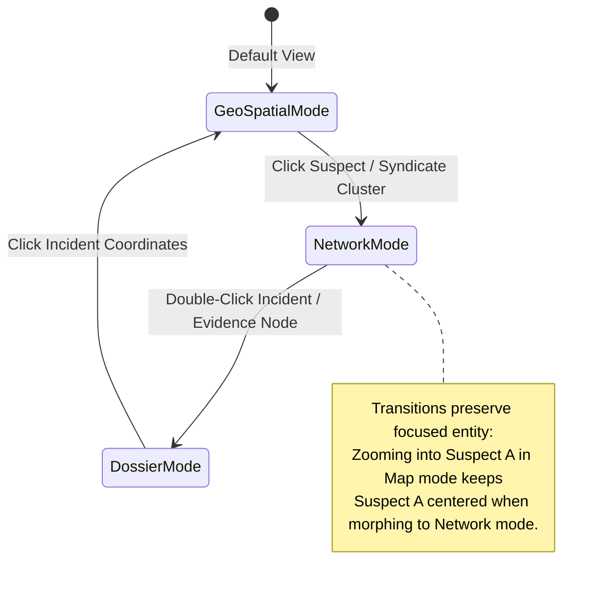

# UI/UX Design Specification: The Sentinel Command Deck

> **Project:** Next-Generation Crime Intelligence & Tactical Operations System  
> **Interaction Model:** Unified Single-Surface War Room (Morphing Tactical Lens + Ambient AI Copilot + Temporal Scrubber)  
> **Visual Aesthetic:** High-Contrast Cyber-Tactical Military SOC (Deep Slate/Navy, Electric Cyan, Neon Amber, Tactical Crimson)

---

## 1. The Interaction Paradigm Shift

### Why Traditional Law Enforcement UIs Fail
Standard law enforcement tools suffer from **context fragmentation**:
- Users click a sidebar to go to `/cases`, search a name, copy an FIR number.
- They click `/map` to see where it happened, losing their place in the table.
- They click `/network` to see who is connected, having to search the name again.
- They click `/ai` to ask questions in an isolated chatbot bubble.

This back-and-forth context switching breaks investigator flow and hides non-obvious criminal connections.

### The New Paradigm: The "Sentinel Command Deck"
Instead of separate disjointed pages, the entire system operates as a **single, responsive, multi-modal Tactical Deck**:

```
┌──────────────────────────────────────────────────────────────────────────────────────────────┐
│  TOP BAR: Jurisdiction Selector | Active Mission | Global Command Palette (Cmd+K) | Voice HUD │
├─────────────────────────────────────────────────────────────┬────────────────────────────────┤
│                                                             │                                │
│                     THE TACTICAL LENS                       │        AMBIENT COPILOT         │
│               (Seamlessly Morphing Canvas)                  │        (Live AI Stream)        │
│                                                             │                                │
│   [ GEO MAP ]  ◄────────►  [ NETWORK GRAPH ] ◄────────►  [ FIR DOSSIER ]                     │
│                                                             │  • Real-time Hypotheses        │
│   • Fluid state transitions (no page reloads)               │  • Proactive Cross-Links       │
│   • Persistent entity focus (selecting Suspect A on Map     │  • Natural Language Action Bar │
│     keeps them focused when morphing into Network)          │  • Instant Translation (KN/EN) │
│   • Interactive Bounding Box / Spatial Lasso                │  • One-Click Action Trigger    │
│                                                             │                                │
├─────────────────────────────────────────────────────────────┴────────────────────────────────┤
│  BOTTOM RAIL: Temporal Incident Scrubber (Time-Travel Playback: 24h · 7d · 30d · Custom)      │
└──────────────────────────────────────────────────────────────────────────────────────────────┘
```

---

## 2. Core Interaction Pillars

### 2.1. Pillar 1: The Morphing Tactical Lens
The center stage is a unified visual surface with **three projection modes** that share identical selection state and camera coordinates:



1. **Geo-Spatial Projection (Tactical GIS)**:
   - Incident pins are color-coded and animated by severity.
   - Heatmap toggle displays dynamic density fields.
   - Drawing a spatial boundary (Lasso / Rectangle) isolates all incidents, accused persons, and patrols within that perimeter.
2. **Relational Topology Projection (Network Graph)**:
   - When the investigator wants to understand *who is pulling the strings*, one shortcut (`Tab` or Mode Toggle) morphs the map pins into force-directed network nodes.
   - Geographic coordinates smoothly translate into relational clusters (gang syndicates, co-accused pairs, shared phone numbers).
3. **Structured Dossier Projection (FIR Ledger & Evidence Vault)**:
   - Focuses on legal and evidentiary specifics: IPC/BNS statutory codes, witness records, CCTV attachments, and chain-of-custody logs.
   - Opens as a seamless side-sliding sheet or full-width grid without losing underlying spatial/relational filters.

---

### 2.2. Pillar 2: The Ambient AI Copilot (Omnipresent Side-Car)
The AI is **never hidden behind a separate `/ai` route**. It is a persistent sidecar that functions as an intelligent partner sitting next to the investigator:

1. **Passive Ambient Awareness**:
   - As the investigator explores cases or pans across districts, the Copilot analyzes what is on screen and surfaces **"Live Intelligence Flashes"**:
     > *"⚠️ Pattern Detected: 3 burglaries in Indiranagar within the last 48h share the same MO (rear window latch forced, gold jewelry targeted). Suspect 'Kiran alias Snake' was bailed 4 days ago and resides 1.2km away."*
2. **Conversational Action Execution (Not Just Text)**:
   - The Copilot doesn't just answer questions; it can manipulate the Command Deck:
     - *Officer:* `"Show me all cases involving weapons in K.R. Puram during last week"`
     - *Copilot:* Responds in text/voice **AND** automatically sets the Temporal Scrubber to last week, filters the Map to K.R. Puram, and highlights weapon-related FIR pins.
3. **Bilingual Dual-Mode (English & Kannada / ಕನ್ನಡ)**:
   - Instant language toggle at the top of the sidecar.
   - Full synthesis in natural spoken Kannada for local station sub-inspectors and constables.
   - Integrated push-to-talk voice button (microphone HUD) for hands-free field tablet operation.

---

### 2.3. Pillar 3: Temporal Incident Scrubber (Time-Travel Playback)
Along the bottom of the interface sits a tactile, interactive timeline:

```
[ ⏮ ] [ ⏵ PLAY ] [ ⏭ ]  ──●───────────────────────────────  [ 1x / 2x / 5x Speed ]
OCT 01                      OCT 14 (Active Head)               OCT 23
├─ Burglary Surge (Indiranagar)   ├─ Repeat Offender Arrested    ├─ Live Incident Stream
```

- **Interactive Scrubbing**: Dragging the playhead backward dynamically rewinds the map and network graph, showing how a criminal ring developed and expanded chronologically.
- **Velocity Sparkline**: The background of the scrubber displays a subtle incident volume bar-chart, showing spikes in criminal activity over time.
- **Event Callout Markers**: Key milestones (e.g., gang clashes, major bail releases, crackdowns) appear as interactive flags along the timeline.

---

### 2.4. Pillar 4: Investigation Scratchpad & "Pin-to-Dossier"
During an active inquiry, an officer encounters disparate clues across the Map, Graph, and FIR Explorer.

- **One-Click Pinning**: Every card, suspect node, map snapshot, or AI insight has a quick `Pin (📌)` button.
- **The Caseboard Tray**: Pinned items dock into a collapsible bottom/side scratchpad called the **Active Briefing Deck**.
- **Instant Dossier Generation**: Clicking `"Synthesize Intelligence Brief"` transforms all pinned elements into a court-ready, classified PDF dossier with official seals and watermarks in under 2 seconds.

---

## 3. Keyboard & Voice-First HUD (Efficiency Architecture)

Law enforcement operations demand lightning-fast actions without hunting through deep dropdown menus:

| Interaction / Hotkey | Action Triggered |
| :--- | :--- |
| `Cmd + K` or `Ctrl + K` | **Global Command Palette**: Instant omni-search for FIR numbers, suspect names, vehicle plates, or statutory sections. |
| `Space` (Hold) | **Push-to-Talk Voice Command**: Activates browser STT; speaking a query routes directly to the Ambient Copilot. |
| `1` / `2` / `3` | **Instant Mode Morph**: `1` = Geo Map, `2` = Network Topology, `3` = FIR Dossier Table. |
| `L` | **Lasso Tool**: Toggles spatial polygon drawing on the map. |
| `Esc` | Clears active focus and returns to the macro district view. |
| `Shift + P` | Pins the currently selected entity to the Active Briefing Scratchpad. |

---

## 4. Visual Design System & Aesthetics

### 4.1. Color Palette: "Tactical Midnight"
The UI employs a high-contrast dark palette designed for extended viewing in low-light tactical control rooms, avoiding fatigue while prioritizing high-urgency alerts:

```css
:root {
  /* Background Foundations */
  --bg-deck-deep: #050b14;        /* Deep tactical void */
  --bg-deck-surface: #0a1322;     /* Control surface */
  --bg-deck-panel: #0f1d33;       /* Glassmorphic card panels */
  --border-deck: rgba(255, 255, 255, 0.08);
  --border-deck-glow: rgba(6, 182, 212, 0.25);

  /* Primary Threat & Status Colors */
  --color-critical: #ef4444;      /* High-risk suspects, violent FIRs */
  --color-warning: #f59e0b;       /* Moderate risk, pending investigation */
  --color-resolved: #10b981;      /* Closed cases, arrested co-accused */
  --color-intel-cyan: #06b6d4;    /* AI insights, network links, selection rings */
  --color-accent-purple: #8b5cf6; /* Digital evidence, cyber crimes */

  /* Typography Colors */
  --text-primary: #f8fafc;
  --text-secondary: #94a3b8;
  --text-muted: #64748b;
  --text-mono-cyan: #22d3ee;
}
```

### 4.2. Visual Component Anatomy

#### 1. Glassmorphic Surface Cards
- Subtle translucent panels (`backdrop-blur-md bg-deck-panel/85 border border-white/10`).
- Thin electric cyan accent lines indicating active selection state.
- Hover states with subtle inner glow effects (`box-shadow: 0 0 15px rgba(6, 182, 212, 0.15)`).

#### 2. Suspect & Entity Nodes (Network Graph)
- Hexagonal or rounded-square avatar cards with color-coded risk borders (Crimson for Critical, Amber for Medium).
- Pulsing glow animation on repeat offenders.
- Badges displaying active FIR count, primary gang label, and bail status.

#### 3. Map Marker Pins
- Custom SVG radar beacons with concentric pulse waves for incidents under 24 hours old.
- Distinct glyph symbols inside pins (Weapons, Narcotics, Cyber, Burglary).

---

## 5. Screen Layout & Wireframe Blueprint

```
┌───────────────────────────────────────────────────────────────────────────────────────────────────────────────────────┐
│ [🛡️ SENTINEL CIOS]  [Jurisdiction: BENGALURU CITY ▼]   [🔎 Search FIRs, Suspects, Weapons (Cmd+K)]   [🎤 Push-to-Talk]│
├─────────────────────────────────────────────────────────────────────────────┬─────────────────────────────────────────┤
│ [MODE: 🗺️ GEO-MAP (1) | 🕸️ NETWORK (2) | 📋 DOSSIER (3)]  [Lasso Tool (L)]   │ 🤖 AMBIENT COPILOT          [KN | EN]   │
├─────────────────────────────────────────────────────────────────────────────┼─────────────────────────────────────────┤
│                                                                             │ [LIVE HYPOTHESIS FLASH]                 │
│                                                                             │ ⚠️ High probability that FIR #102/24    │
│                                                                             │ and #215/24 share the same stolen       │
│                                                                             │ vehicle (KA-04-E-1234).                 │
│                                                                             │                                         │
│                                                                             │ [EVIDENCE NEXUS]                        │
│                                                                             │ • Suspect: Raju alias Snake             │
│                        THE TACTICAL LENS                                    │ • Prior arrests: 4 (Robbery)            │
│                 (Interactive Map / Network / Grid)                          │ • Assigned IO: Inspector Patil          │
│                                                                             │                                         │
│                                                                             │ ─────────────────────────────────────── │
│                                                                             │ [INVESTIGATION CHAT]                    │
│                                                                             │ Officer: "Summarize Raju's associates"  │
│                                                                             │ Copilot: Found 3 co-accused in Indiran- │
│                                                                             │ agar jurisdiction. (Citing FIR #88/24)  │
│                                                                             │                                         │
│                                                                             │ ┌─────────────────────────────────────┐ │
│                                                                             │ │ Ask a question or issue command... 🎙️│ │
│                                                                             │ └─────────────────────────────────────┘ │
├─────────────────────────────────────────────────────────────────────────────┴─────────────────────────────────────────┤
│ 📌 ACTIVE CASEBOARD (3 Pinned Items) | [Export Briefing PDF] | [Share Link]                                           │
├───────────────────────────────────────────────────────────────────────────────────────────────────────────────────────┤
│ ⏪ ◀ PLAY ▶ ⏩  [●───────────────|──────────────────────────────] OCT 23, 2026 (Live)   [Filter: All Categories ▼]   │
└───────────────────────────────────────────────────────────────────────────────────────────────────────────────────────┘
```

---

## 6. Micro-Interactions & Animation Guidelines

1. **Lens Morph Transition**:
   - When switching between Map and Network, use **Framer Motion layout animations**. Pins smoothly glide from geographic coordinates to topological network cluster positions rather than flickering off and on.
2. **Ambient Threat Pulse**:
   - When an anomaly or repeat offender is detected, the Copilot sidecar emits a gentle, non-intrusive glowing pulse along its left border (`animation: subtleGlow 2s ease-in-out`).
3. **Timeline Scrubbing Feedback**:
   - Scrubbing the timeline applies an instantaneous visual filter to markers on the map, fading out incidents outside the time window with CSS opacity transitions (150ms).
4. **Haptic & Audio Cues (Optional/Configurable)**:
   - Subtle tactical clicks for filter toggles and voice activation confirmations.

---

## 7. Responsive & Multi-Screen Strategy

- **Large Command Monitors (Dual 4K / Ultrawide SOC Stations)**:
  - Tactical Lens expands to occupy full left/center width; Ambient Copilot and Pinned Caseboard remain permanently visible side-by-side.
- **Field Tablets (iPad Pro / Rugged Toughbooks)**:
  - Touch-optimized tap targets (minimum 44x44px).
  - Ambient Copilot converts to a bottom pull-up drawer.
  - Large Push-to-Talk microphone button pinned to bottom-right corner for hands-free interrogation.
